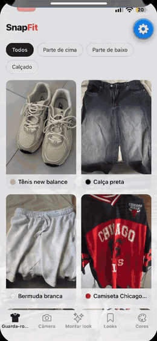
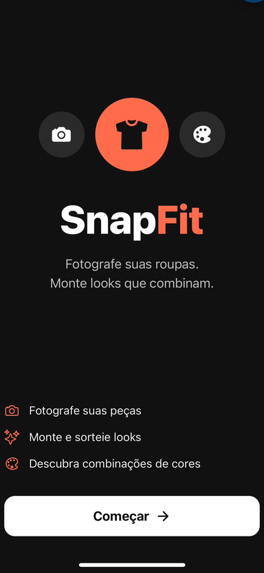
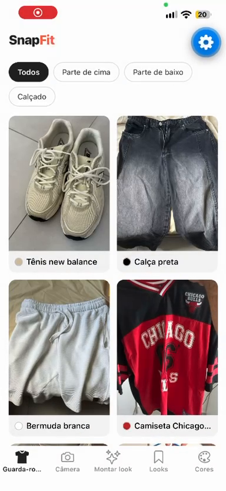
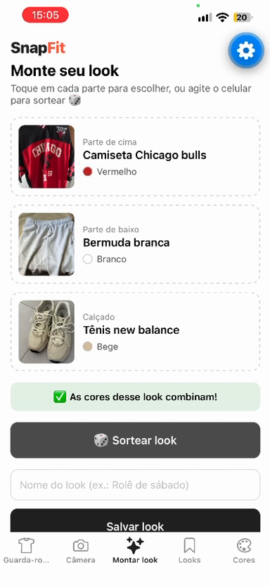
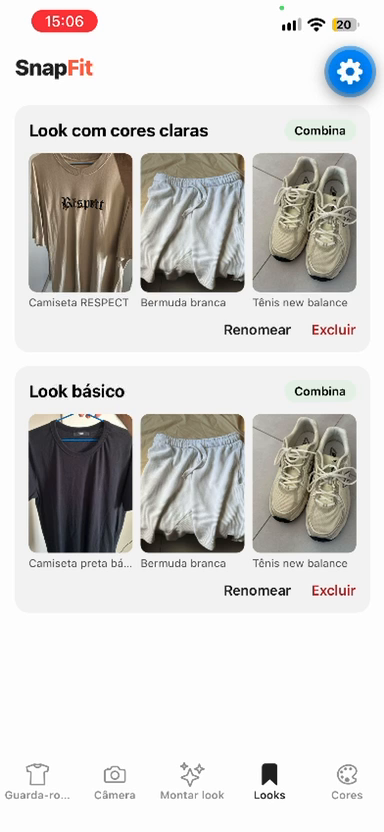
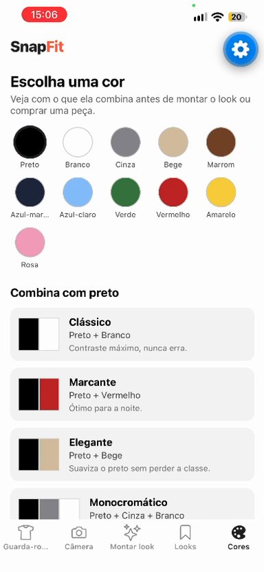

# SnapFit

Aplicativo mobile para organizar o guarda-roupa e montar looks com cores que combinam.

**Autor:** Kauan Elias Silva Ribeiro (RA: 22.126.124-1)

---

## Visão Geral e Requisitos

### Tema

Muita gente tem roupa de sobra no armário, mas na hora de se vestir não sabe o que combina com o quê. O **SnapFit** é um guarda-roupa digital: você fotografa as suas peças, informa o tipo e a cor de cada uma, e o app ajuda a montar looks que combinam. Se faltar ideia, é só agitar o celular para o app sortear um look.

### Objetivos

- Reunir todas as peças do usuário em um único lugar, com foto, tipo e cor.
- Ajudar a montar looks, avisando quando as cores das peças combinam ou não.
- Tornar a escolha da roupa mais rápida e divertida com o sorteio por movimento.
- Ensinar combinações de cores, mostrando o que combina com cada cor antes de montar um look ou comprar uma peça.

### Requisitos

| # | Requisito |
| --- | --- |
| R01 | Cadastrar uma peça com nome, tipo (parte de cima, parte de baixo ou calçado), cor e foto. |
| R02 | Tirar a foto da peça pela câmera do próprio app. |
| R03 | Listar as peças do guarda-roupa e filtrar por tipo. |
| R04 | Ver, editar e excluir uma peça. |
| R05 | Montar um look escolhendo uma peça de cada tipo e indicar se as cores combinam. |
| R06 | Sortear um look que combine ao agitar o celular. |
| R07 | Salvar looks com um nome, além de renomear e excluir. |
| R08 | Consultar quais cores combinam com uma cor escolhida e quais peças do usuário têm essas cores. |

### CRUD

O projeto tem CRUD completo em duas coleções do Firebase Firestore: **peças** e **looks**.

#### Peças (coleção `pecas`)

| Operação | Onde acontece no app | Arquivo |
| --- | --- | --- |
| **Create** (criar) | Tela *Cadastrar peça*, botão de salvar | `src/screens/CadastrarPecaScreen.js` |
| **Read** (ler) | Lista do *Guarda-roupa* e tela *Detalhe da peça* | `src/screens/GuardaRoupaScreen.js`, `src/screens/DetalhePecaScreen.js` |
| **Update** (editar) | Tela *Detalhe da peça*, editando nome, tipo e cor | `src/screens/DetalhePecaScreen.js` |
| **Delete** (excluir) | Tela *Detalhe da peça*, botão de excluir com confirmação | `src/screens/DetalhePecaScreen.js` |

#### Looks (coleção `looks`)

| Operação | Onde acontece no app | Arquivo |
| --- | --- | --- |
| **Create** (criar) | Tela *Montar look*, botão "Salvar look" | `src/screens/MontarLookScreen.js` |
| **Read** (ler) | Lista de *Looks salvos* | `src/screens/LooksSalvosScreen.js` |
| **Update** (editar) | *Looks salvos*, botão "Renomear" | `src/screens/LooksSalvosScreen.js` |
| **Delete** (excluir) | *Looks salvos*, botão "Excluir" com confirmação | `src/screens/LooksSalvosScreen.js` |

As funções do Firestore usadas são `addDoc` (create), `onSnapshot` e `getDoc` (read), `updateDoc` (update) e `deleteDoc` (delete).

---

## Tecnologias Utilizadas

| Categoria | Ferramenta / Biblioteca | Para que foi usada |
| --- | --- | --- |
| Linguagem | JavaScript | Linguagem de todo o projeto |
| Framework | React Native 0.88 + React 19 | Construção da interface |
| Plataforma | Expo SDK 58 | Execução, build e acesso a recursos nativos |
| Navegação | React Navigation (`native-stack` e `bottom-tabs`) | Navegação entre telas e barra de abas |
| Banco de dados | Firebase Firestore | Armazenamento das peças e looks em nuvem |
| Câmera | `expo-camera` | Tirar foto das peças |
| Sensores | `expo-sensors` (acelerômetro) | Detectar quando o celular é agitado |
| Vibração | `expo-haptics` | Feedback tátil no sorteio e nas seleções |
| Imagens | `expo-image-manipulator` | Redimensionar e comprimir as fotos |
| Ícones | `@expo/vector-icons` (Ionicons) | Ícones das abas e das telas |
| Ferramentas | VS Code, Expo Go, Git e GitHub | Desenvolvimento, testes no celular e versionamento |

---

## Funcionalidades

### Tela de capa
Tela de abertura com a marca do app, o slogan *"Fotografe suas roupas. Monte looks que combinam."*, um resumo dos recursos e o botão **Começar**.

### Guarda-roupa
Mostra todas as peças cadastradas em uma grade com foto, nome e cor. No topo há filtros por tipo (**Todos**, **Parte de cima**, **Parte de baixo** e **Calçado**). As peças são atualizadas em tempo real com o Firestore: uma peça cadastrada aparece na lista sem precisar recarregar. Se ainda não houver peças, aparece uma mensagem explicando como começar.

### Câmera
Abre a câmera traseira para fotografar a peça. Na primeira vez, o app pede permissão de uso da câmera. Depois da foto, aparece uma prévia com três opções:
- **Salvar no guarda-roupa**: abre o cadastro da peça com a foto já preenchida;
- **Usar no look agora**: leva a foto direto para a tela de montar look, onde o usuário escolhe se ela é parte de cima, de baixo ou calçado, sem precisar cadastrar a peça;
- tirar a foto de novo.

### Cadastro de peça
Formulário com nome, tipo e cor da peça (escolhida em uma paleta de 11 cores). Antes de salvar, a foto é redimensionada para 600 px de largura e comprimida em JPEG. O app avisa se algum campo obrigatório ficou em branco.

### Detalhe da peça
Mostra a peça em tamanho maior e permite **editar** as informações ou **excluir** a peça, com confirmação antes da exclusão.

### Montar look
O usuário toca em cada espaço (parte de cima, parte de baixo e calçado) e escolhe uma peça. O app mostra na hora se as cores do look **combinam** ou não. Depois é só dar um nome ao look e salvar.

### Agite para sortear
Na tela de montar look, o acelerômetro fica ativo. Ao agitar o celular, o app embaralha as peças e encontra uma combinação de parte de cima, parte de baixo e calçado em que todas as cores combinam entre si. O sorteio vem com vibração de confirmação. Para não disparar várias vezes seguidas, há um intervalo mínimo entre uma agitada e outra.

### Looks salvos
Lista os looks salvos com as fotos das três peças e o selo **Combina**. Cada look pode ser **renomeado** ou **excluído**.

### Combinação de cores
O usuário escolhe uma cor e vê as combinações sugeridas para ela (por exemplo *Clássico: Preto + Branco* ou *Marcante: Preto + Vermelho*), cada uma com uma explicação curta. Abaixo aparecem as peças do próprio guarda-roupa que têm as cores daquela combinação.

#### Como a combinação é calculada
O arquivo `src/data/cores.js` define as cores e os grupos de cores que combinam com cada uma. Em `src/utils/combinacao.js`:
- `combinam(corA, corB)` retorna verdadeiro se as cores forem iguais ou se uma estiver nas combinações da outra;
- `lookCombina(pecas)` confere se **todos os pares** de peças do look combinam entre si.

---

## Demonstração

<p align="center">
  
</p>

| Capa | Guarda-roupa | Montar look | Looks salvos |
| :---: | :---: | :---: | :---: |
|  |  |  |  |
| **Cores** | | | |
|  | | | |

---

## Instalação e Execução

### Pré-requisitos

- Node.js (versão LTS)
- Git
- App **Expo Go** instalado no celular (Android ou iOS), ou um emulador

### Passo a passo

Primeiro, clone o repositório:

```bash
git clone https://github.com/Kauan494/snapfit.git
cd snapfit
```

Depois, escolha uma das duas opções abaixo para iniciar o app.

#### Opção 1: Execução comum (recomendada)

Para quem está com o celular e o computador na mesma rede Wi-Fi.

1. Instale as dependências:

   ```bash
   npm install
   ```

2. Inicie o servidor:

   ```bash
   npx expo start
   ```

3. Abra o app **Expo Go** no celular e escaneie o QR Code que aparece no terminal (no iPhone, use a câmera).

**Requisitos:** celular e computador na mesma rede Wi-Fi, sem VPN, e o Node.js liberado no firewall do Windows (com a rede configurada como **Privada**).

#### Opção 2: Execução com login por token (quando a Opção 1 falha)

Use esta opção se aparecerem erros como *"The request timed out"* ou *"You're signed in to Expo Go as ..., but not signed in to Expo CLI"*, ou se o `npx expo login` falhar por não conseguir abrir o navegador.

1. Acesse `expo.dev/settings/access-tokens`, entre na sua conta Expo e crie um **Personal Access Token**.
2. No PowerShell, defina o token e inicie o projeto em modo túnel:

   ```powershell
   $env:EXPO_TOKEN="cole_o_token_aqui"
   npx expo whoami
   npx expo start --tunnel
   ```

3. Confira se o `npx expo whoami` mostra o usuário da sua conta Expo.
4. Escaneie o QR Code com o **Expo Go**, logado na **mesma conta** usada no terminal.

> **Atenção:** nunca faça commit nem compartilhe o seu token. Se ele vazar, revogue o token na mesma página em que ele foi criado e gere outro.

Observações:

- O token vale apenas para o terminal em que foi definido. Para deixá-lo permanente, rode o comando abaixo e abra um novo terminal:

  ```powershell
  setx EXPO_TOKEN "seu_token"
  ```

- O modo `--tunnel` pode pedir para instalar o `@expo/ngrok`. Responda `y`.
- Alternativa sem token: saia da conta no Expo Go (**Settings → Log out**) e use a Opção 1.

#### Outras formas de executar

Também é possível usar:

```bash
npm run android   # abre no emulador Android
npm run ios       # abre no simulador iOS (somente macOS)
npm run web       # abre no navegador
```

> A câmera, o acelerômetro e a vibração só funcionam em um celular de verdade.

### Configuração do Firebase (opcional)

O projeto já vem conectado a um banco do Firebase. Para usar o seu próprio banco:

1. Crie um projeto no console do Firebase e adicione um app **Web**.
2. Ative o **Cloud Firestore**.
3. Substitua os dados de `firebaseConfig` em `src/config/firebase.js`.

O app usa duas coleções, criadas automaticamente quando a primeira peça e o primeiro look são salvos:

| Coleção | O que guarda |
| --- | --- |
| `pecas` | Nome, tipo (`cima`, `baixo`, `calcado`), cor, foto (base64) e data de criação |
| `looks` | Nome, peças escolhidas e data de criação |

### Estrutura do projeto

```
snapfit/
├── App.js                       Navegação (stack + abas)
├── index.js                     Ponto de entrada
├── app.json                     Configuração do Expo
├── docs/                        Prints e GIF usados neste README
└── src/
    ├── components/
    │   ├── EstadoVazio.js       Mensagem exibida em listas vazias
    │   └── Intro.js             Logo "SnapFit"
    ├── config/
    │   └── firebase.js          Inicialização do Firebase/Firestore
    ├── data/
    │   └── cores.js             Cores, tipos de peça e tabela de combinações
    ├── screens/
    │   ├── CapaScreen.js
    │   ├── GuardaRoupaScreen.js
    │   ├── CameraScreen.js
    │   ├── CadastrarPecaScreen.js
    │   ├── DetalhePecaScreen.js
    │   ├── MontarLookScreen.js
    │   ├── LooksSalvosScreen.js
    │   └── CombinacaoCoresScreen.js
    └── utils/
        ├── combinacao.js        Regras para saber se duas cores / um look combinam
        └── imagem.js            Redimensiona e comprime fotos (base64)
```

---

## Aprendizados e Próximos Passos

### Aprendizados

O SnapFit foi o meu primeiro aplicativo para celular, e quase tudo nele foi novidade para mim:

- **Câmera:** eu ainda não sabia fazer um app que usasse a câmera. Aprendi a pedir a permissão do usuário, tirar a foto e mostrar uma prévia antes de usar a imagem.
- **Acelerômetro:** também nunca tinha usado. Aprendi a ler os valores do sensor e a transformar o movimento de agitar o celular em uma ação dentro do app.
- **Firestore:** foi a primeira vez que usei esse banco de dados. Aprendi a salvar, ler, editar e excluir dados na nuvem e a deixar as telas atualizando em tempo real.
- **Desenvolvimento mobile:** entendi como funciona um app com React Native e Expo, desde a navegação entre telas até testar tudo direto no celular pelo Expo Go.

### Próximos passos

- **Login de usuários** (Firebase Authentication), para que cada pessoa tenha o seu próprio guarda-roupa. Hoje todos os usuários compartilham os mesmos dados.
- **Guardar as fotos no Firebase Storage** em vez de base64 no Firestore, que tem limite de 1 MB por documento.
- **Mais categorias de peças**, como acessórios, casacos e vestidos.
- **Detecção automática da cor** da peça a partir da foto.
- **Sugestões por ocasião ou clima** (trabalho, festa, dia frio).
- **Escolher foto da galeria**, além da câmera.
